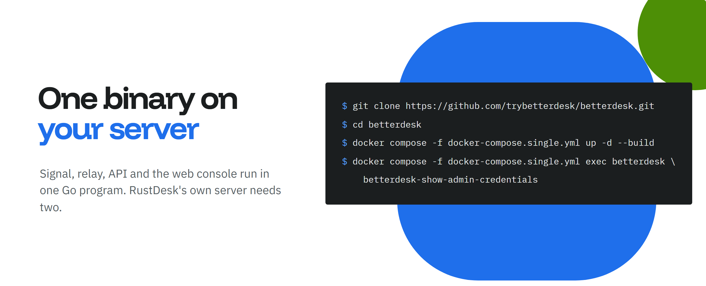
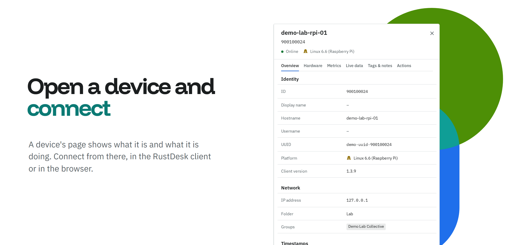
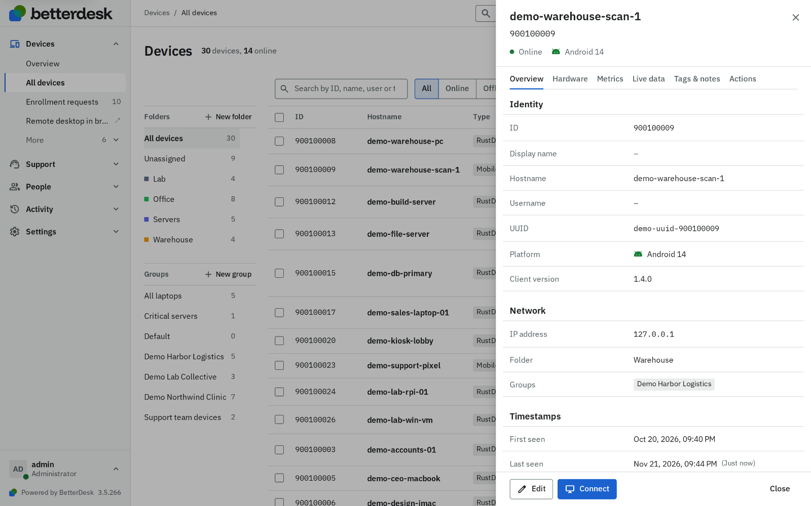
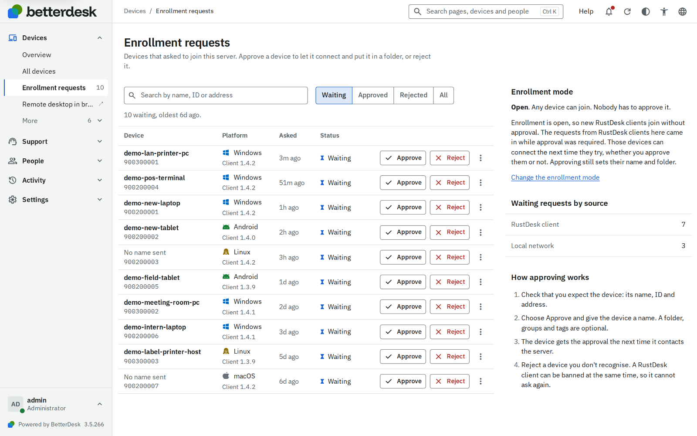
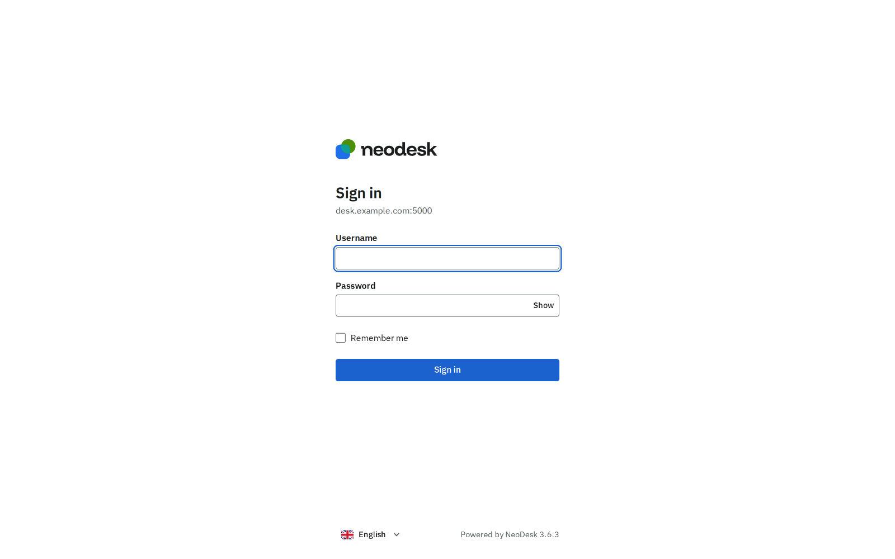

<p align="center">
  <a href="https://neode.sk">
    <picture>
      <source media="(prefers-color-scheme: dark)" srcset="docs/assets/readme/hero-dark.png">
      
    </picture>
  </a>
</p>

<p align="center">
  <a href="CHANGELOG.md"><picture><source media="(prefers-color-scheme: dark)" srcset="docs/assets/badges/dark/version.svg"></picture></a>
  <a href="LICENSE"><picture><source media="(prefers-color-scheme: dark)" srcset="docs/assets/badges/dark/license.svg"></picture></a>
  <a href="neodesk-server"><picture><source media="(prefers-color-scheme: dark)" srcset="docs/assets/badges/dark/go.svg"></picture></a>
  <a href="web-ui"><picture><source media="(prefers-color-scheme: dark)" srcset="docs/assets/badges/dark/svelte.svg"></picture></a>
  <a href="#connect-a-rustdesk-client"><picture><source media="(prefers-color-scheme: dark)" srcset="docs/assets/badges/dark/rustdesk.svg"></picture></a>
</p>

NeoDesk is a remote desktop server you run yourself. It speaks the RustDesk
protocol, so the normal RustDesk client connects to it, and it comes with a web
console for the devices you look after. Your data stays on your server: the
project sends no analytics, crash reports or usage data anywhere
([Privacy](https://neode.sk/docs/project/privacy)).

Getting help: ask on the [NeoDesk Discord](https://discord.gg/nwERSawufr) or in
[GitHub Discussions](https://github.com/neodeskapp/neodesk/discussions).

## One binary on your server

<picture>
  <source media="(prefers-color-scheme: dark)" srcset="docs/assets/readme/server-dark.png">
  
</picture>

RustDesk's own server is two programs, hbbs and hbbr. NeoDesk does both jobs
in one Go binary, and the same binary answers the client API and serves the web
console. It stores its data in SQLite, or in PostgreSQL if you prefer.

## Works with the RustDesk client

<picture>
  <source media="(prefers-color-scheme: dark)" srcset="docs/assets/readme/client-dark.png">
  
</picture>

There is no other client to install. A RustDesk client needs four values in its
network settings: the ID server, the relay server, the API server and the key.
The console's overview page shows all four with a copy button, and **Show QR**
puts them in one code for a phone.

## Every device in one list

<picture>
  <source media="(prefers-color-scheme: dark)" srcset="docs/assets/readme/console-dark.png">
  
</picture>

Search by ID, name, user or platform. Put devices in folders and groups, and
give them your own tags. The console is translated into 26 languages and has a
light and a dark theme.

## Open a device and connect

<picture>
  <source media="(prefers-color-scheme: dark)" srcset="docs/assets/readme/device-dark.png">
  
</picture>

Click a device to see what it is and what it is doing, then connect to it from
there. Around that, the console has what a team needs to share a server:

- **Enrollment requests:** when approval is required, a new RustDesk client waits until someone approves it.
- **Users and roles:** each person signs in with their own account, and their role decides what they can do.
- **Sign-in:** two-factor sign-in, LDAP or Active Directory, and OIDC. The NeoDesk app on a computer can sign in through the console in the browser, without typing a password into the app.
- **Activity:** a log of what people do in the console.

## Install

The [documentation](https://neode.sk/docs) has each way step by step.
The addresses on neode.sk lead to the installers of the newest release.
Every [release](https://github.com/neodeskapp/neodesk/releases) has them
attached too, for installing one version.

### Docker

One container runs the server and the web console from the published image
`ghcr.io/neodeskapp/neodesk`. The script sets it up in
`/opt/neodesk/docker`, installs Docker when it is missing, and prints the
admin password at the end:

```bash
curl -fsSL https://neode.sk/install.sh | sudo bash
```

Or with the compose file by hand:

```bash
mkdir neodesk && cd neodesk
curl -fsSL https://neode.sk/install/docker-compose.quick.single.yml -o docker-compose.yml
docker compose up -d
docker compose exec neodesk neodesk-show-admin-credentials
```

The console is then at `http://your-server:3375`, which is plain HTTP. See
[Install with Docker](https://neode.sk/docs/getting-started/docker).

For HTTPS with a certificate that renews by itself, give a DNS name that
points at the server. A small Traefik container then gets a Let's Encrypt
certificate and serves the console on ports 80 and 443:

```bash
curl -fsSL https://neode.sk/install.sh | sudo bash -s -- \
  --domain console.example.com --letsencrypt-email admin@example.com
```

`neodesk-docker.sh --domain ... --email ...` does the same for an existing
install, and `--no-traefik` turns it off again. Add `--letsencrypt-staging`
to test with Let's Encrypt's staging server first.

### Linux

```bash
curl -fsSL https://neode.sk/neodesk.sh | sudo bash
```

This installs the newest release as the service `neodesk-server` with the
default settings and shows the admin password. To answer the installer's
questions instead, download `neodesk.sh` and run it with `sudo bash`. See
[Install on Linux](https://neode.sk/docs/getting-started/linux).

### Windows

In PowerShell as Administrator:

```powershell
Invoke-WebRequest https://neode.sk/neodesk.ps1 -OutFile neodesk.ps1 -UseBasicParsing
.\neodesk.ps1
```

Add `-Auto` to install with the default settings. See
[Install on Windows](https://neode.sk/docs/getting-started/windows).

## Connect a RustDesk client

1. Install the [RustDesk client](https://rustdesk.com) on the device.
2. In the console, open **Devices**, then **Overview**. The **Client setup**
   column shows the ID server, relay server, API server and key for the
   address under **Client server address**.
3. Copy them into the client's network settings, in the ID/Relay server
   section. **Copy all** copies them together, and **Show QR** is for phones.

The device then waits under **Enrollment requests** until someone approves
it, as every new install starts in the Managed enrollment mode. See
[Connect a RustDesk client](https://neode.sk/docs/getting-started/connect-a-client).

## Ports

| Port | Used for |
|------|----------|
| 3375 | Web console (HTTP; 5000 up to 3.6.0-rc.4) |
| 21115 | NAT type test |
| 21116, TCP and UDP | ID server |
| 21117 | Relay server |
| 21118, 21119 | ID and relay server over WebSocket |
| 21121 | API server for RustDesk clients |
| 21122 | CDAP gateway for device agents |

Open 21115 to 21117 and 21121 to the networks your devices connect from, and
21118, 21119 and 21122 only for clients and agents that use them. Keep 3375
behind a reverse proxy with TLS if the console is reachable from the internet.
[Ports and firewall](https://neode.sk/docs/operations/ports) and
[Reverse proxy and TLS](https://neode.sk/docs/operations/reverse-proxy-tls)
have the details.

## More of the console

Demo data, in both themes.

| | |
|---|---|
| <picture><source media="(prefers-color-scheme: dark)" srcset="docs/assets/readme/screen-overview-dark.png"></picture> | <picture><source media="(prefers-color-scheme: dark)" srcset="docs/assets/readme/screen-devices-dark.png"></picture> |
| Overview | All devices |
| <picture><source media="(prefers-color-scheme: dark)" srcset="docs/assets/readme/screen-device-dark.png"></picture> | <picture><source media="(prefers-color-scheme: dark)" srcset="docs/assets/readme/screen-registrations-dark.png"></picture> |
| Device details | Enrollment requests |
| <picture><source media="(prefers-color-scheme: dark)" srcset="docs/assets/readme/screen-settings-auth-dark.png"></picture> | <picture><source media="(prefers-color-scheme: dark)" srcset="docs/assets/readme/screen-login-dark.png"></picture> |
| Sign-in settings | Sign in |

## Documentation

Everything is on [neode.sk/docs](https://neode.sk/docs):

| Topic | Guides |
|-------|--------|
| Getting started | [Docker](https://neode.sk/docs/getting-started/docker), [Linux](https://neode.sk/docs/getting-started/linux), [Windows](https://neode.sk/docs/getting-started/windows), [first sign-in](https://neode.sk/docs/getting-started/first-sign-in), [moving from a RustDesk server](https://neode.sk/docs/getting-started/migrate-from-rustdesk) |
| Using the console | [The device list](https://neode.sk/docs/console/devices), [enrollment](https://neode.sk/docs/console/enrollment), [remote desktop in the browser](https://neode.sk/docs/console/remote-in-browser) |
| People and sign-in | [Users and roles](https://neode.sk/docs/people/users-and-roles), [two-factor sign-in](https://neode.sk/docs/people/two-factor), [LDAP](https://neode.sk/docs/people/ldap), [OIDC](https://neode.sk/docs/people/oidc) |
| Running the server | [Configuration](https://neode.sk/docs/operations/configuration), [hardening](https://neode.sk/docs/operations/security), [updating](https://neode.sk/docs/operations/updating), [backup](https://neode.sk/docs/operations/backup), [troubleshooting](https://neode.sk/docs/operations/troubleshooting) |
| Development | [Contributing](https://neode.sk/docs/development/contributing), [building from source](https://neode.sk/docs/development/building), [architecture](https://neode.sk/docs/development/architecture), [the HTTP API](https://neode.sk/docs/development/api) |

## License

[AGPL-3.0](LICENSE).

NeoDesk is created and maintained with the assistance of AI tools.
