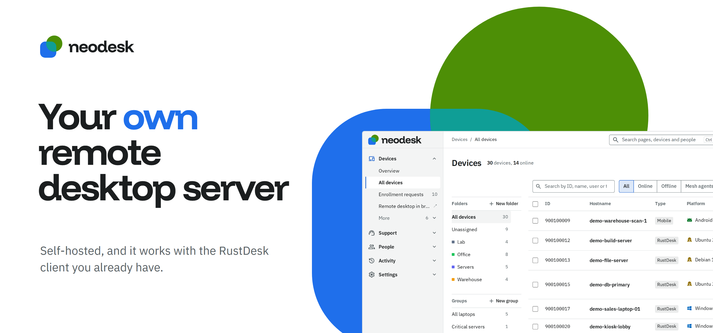
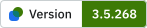
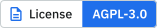
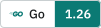
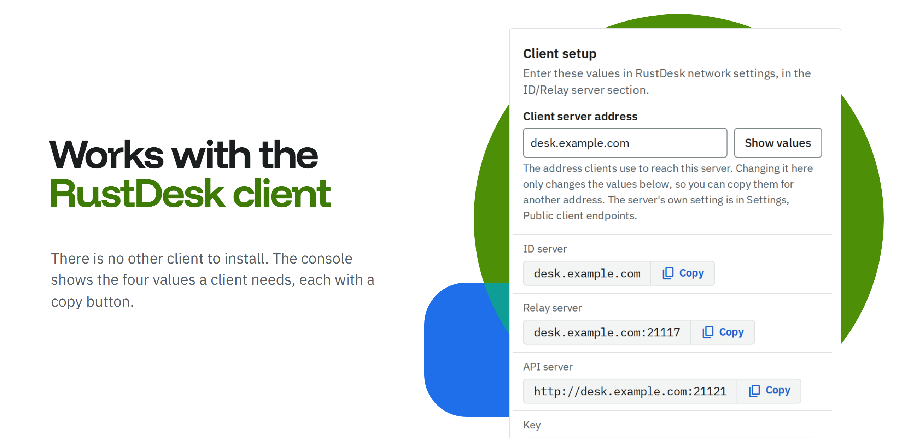
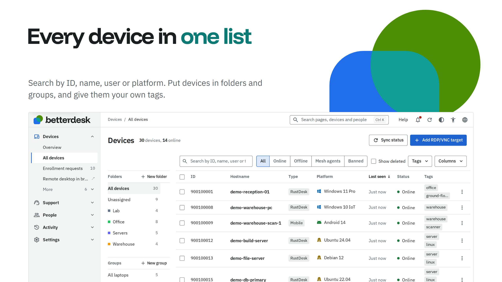
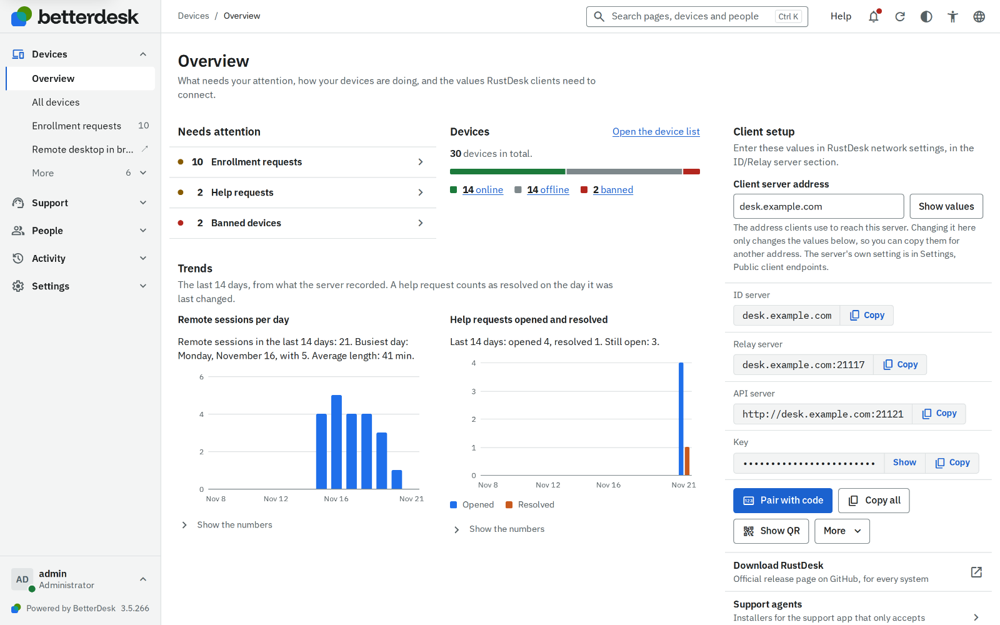
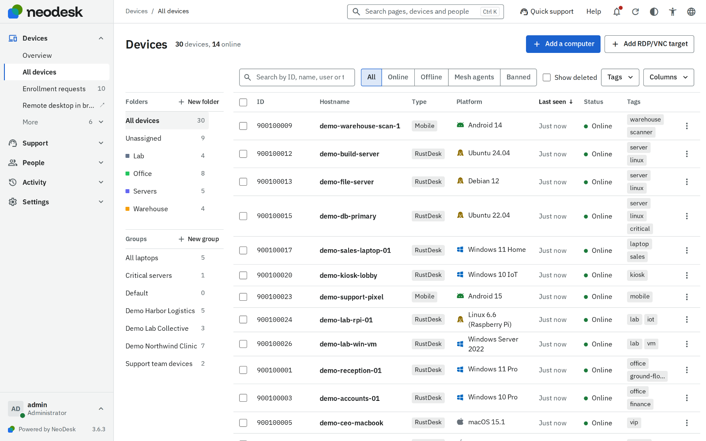
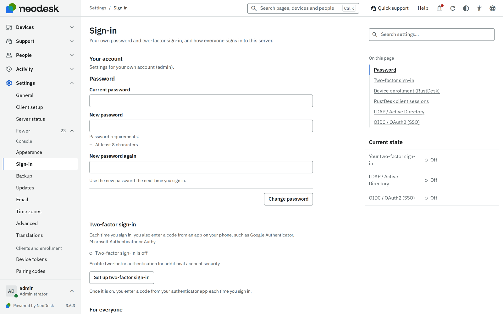

<p align="center">
  <a href="https://betterde.sk">
    <picture>
      <source media="(prefers-color-scheme: dark)" srcset="docs/assets/readme/hero-dark.png">
      
    </picture>
  </a>
</p>

<p align="center">
  <a href="CHANGELOG.md"><picture><source media="(prefers-color-scheme: dark)" srcset="docs/assets/badges/dark/version.svg"></picture></a>
  <a href="LICENSE"><picture><source media="(prefers-color-scheme: dark)" srcset="docs/assets/badges/dark/license.svg"></picture></a>
  <a href="betterdesk-server"><picture><source media="(prefers-color-scheme: dark)" srcset="docs/assets/badges/dark/go.svg"></picture></a>
  <a href="web-ui"><picture><source media="(prefers-color-scheme: dark)" srcset="docs/assets/badges/dark/svelte.svg"></picture></a>
  <a href="#connect-a-rustdesk-client"><picture><source media="(prefers-color-scheme: dark)" srcset="docs/assets/badges/dark/rustdesk.svg"></picture></a>
</p>

BetterDesk is a remote desktop server you run yourself. It speaks the RustDesk
protocol, so the normal RustDesk client connects to it, and it comes with a web
console for the devices you look after. Your data stays on your server: the
project sends no analytics, crash reports or usage data anywhere
([PRIVACY.md](PRIVACY.md)).

This repository is a fork of [UNITRONIX/BetterDesk](https://github.com/UNITRONIX/BetterDesk).
It replaces the Node.js console with one written in Svelte that the Go server
serves itself, so a running install is a single program.

## One binary on your server

<picture>
  <source media="(prefers-color-scheme: dark)" srcset="docs/assets/readme/server-dark.png">
  
</picture>

RustDesk's own server is two programs, hbbs and hbbr. BetterDesk does both jobs
in one Go binary, and the same binary answers the client API and serves the web
console. It stores its data in SQLite, or in PostgreSQL if you prefer.

## Works with the RustDesk client

<picture>
  <source media="(prefers-color-scheme: dark)" srcset="docs/assets/readme/client-dark.png">
  
</picture>

There is no other client to install. A RustDesk client needs four values in its
network settings: the ID server, the relay server, the API server and the key.
The console's overview page shows all four with a copy button, and **Show QR**
puts them in one code for a phone.

## Every device in one list

<picture>
  <source media="(prefers-color-scheme: dark)" srcset="docs/assets/readme/console-dark.png">
  
</picture>

Search by ID, name, user or platform. Put devices in folders and groups, and
give them your own tags. The console is translated into 26 languages and has a
light and a dark theme.

## Open a device and connect

<picture>
  <source media="(prefers-color-scheme: dark)" srcset="docs/assets/readme/device-dark.png">
  
</picture>

Click a device to see what it is and what it is doing, then connect to it from
there. Around that, the console has what a team needs to share a server:

- **Enrollment requests:** when approval is required, a new RustDesk client waits until someone approves it.
- **Users and roles:** each person signs in with their own account, and their role decides what they can do.
- **Sign-in:** two-factor sign-in, LDAP or Active Directory, and OIDC.
- **Activity:** a log of what people do in the console.

## Install

### Docker

One container runs the server and the web console. It builds from this
repository, so the first start takes a few minutes.

```bash
git clone https://github.com/trybetterdesk/betterdesk.git
cd betterdesk
docker compose -f docker-compose.single.yml up -d --build
docker compose -f docker-compose.single.yml exec betterdesk betterdesk-show-admin-credentials
```

The last command prints the admin username and password. Sign in with them at
`http://your-server:5000`, which is plain HTTP, not HTTPS. To update, run
`git pull` and the `up -d --build` command again.

For PostgreSQL instead of SQLite, see the comments at the top of
[docker-compose.single.yml](docker-compose.single.yml).

### Linux

```bash
git clone https://github.com/trybetterdesk/betterdesk.git
cd betterdesk
sudo ./betterdesk.sh
```

Choose **1** in the menu for a new install, or run `sudo ./betterdesk.sh --auto`
to skip the menu. The installer shows the admin username and password.

### Windows

Run `betterdesk.ps1` in PowerShell as Administrator. Add `-Auto` to install
with the default settings.

## Connect a RustDesk client

1. Install the [RustDesk client](https://rustdesk.com) on the device.
2. In the console, open **Devices**, then **Overview**. Enter your server's
   public address under **Client server address**.
3. Copy the ID server, relay server, API server and key into the client's
   network settings, in the ID/Relay server section. **Copy all** copies them
   together, and **Show QR** is for phones.

The device then shows up in the device list, or under **Enrollment requests**
if you require approval.

## Ports

| Port | Used for |
|------|----------|
| 5000 | Web console |
| 21115 | NAT type test |
| 21116, TCP and UDP | ID server |
| 21117 | Relay server |
| 21118, 21119 | ID and relay server over WebSocket |
| 21121 | API server for RustDesk clients |

Open 21115 to 21119 and 21121 to the networks your devices connect from. Keep
5000 behind a reverse proxy with TLS if the console is reachable from the
internet ([TLS guide](docs/wiki/TLS-SSL.md)).

## More of the console

Demo data, in both themes.

| | |
|---|---|
| <picture><source media="(prefers-color-scheme: dark)" srcset="docs/assets/readme/screen-overview-dark.png"></picture> | <picture><source media="(prefers-color-scheme: dark)" srcset="docs/assets/readme/screen-devices-dark.png"></picture> |
| Overview | All devices |
| <picture><source media="(prefers-color-scheme: dark)" srcset="docs/assets/readme/screen-device-dark.png"></picture> | <picture><source media="(prefers-color-scheme: dark)" srcset="docs/assets/readme/screen-registrations-dark.png"></picture> |
| Device details | Enrollment requests |
| <picture><source media="(prefers-color-scheme: dark)" srcset="docs/assets/readme/screen-settings-auth-dark.png"></picture> | <picture><source media="(prefers-color-scheme: dark)" srcset="docs/assets/readme/screen-login-dark.png"></picture> |
| Sign-in settings | Sign in |

## Documentation

The guides are in [docs/wiki](docs/wiki/Home.md). Some of them were written for
the Node.js console and still mention it.

| Topic | Guides |
|-------|--------|
| Setting up | [Installation](docs/wiki/Installation.md), [Docker](docs/wiki/Docker.md), [Client setup](docs/wiki/Client-Setup.md) |
| Running it | [Configuration](docs/wiki/Configuration.md), [TLS](docs/wiki/TLS-SSL.md), [Security](docs/wiki/Security.md), [Monitoring](docs/wiki/Monitoring.md) |
| People | [User management](docs/wiki/User-Management.md), [LDAP and Active Directory](docs/wiki/LDAP-AD.md), [OIDC](docs/wiki/OIDC-SSO.md) |
| Help | [Troubleshooting](docs/wiki/Troubleshooting.md), [FAQ](docs/wiki/FAQ.md) |
| Developers | [docs/](docs/), [API reference](docs/wiki/API-Reference.md), [the console's frontend](web-ui/README.md), [contributing](docs/development/CONTRIBUTING.md) |

## Credits

BetterDesk was created by [UNITRONIX](https://github.com/UNITRONIX), and most
of the server in this repository is that project's work. If BetterDesk is
useful to you, [SPONSORS.md](SPONSORS.md) lists how to support it and who
already does.

BetterDesk is created and maintained with the assistance of AI tools.

## License

[AGPL-3.0](LICENSE). There is an optional Commercial Grant for eligible
sponsors, described in [docs/COMMERCIAL-GRANT.md](docs/COMMERCIAL-GRANT.md).
