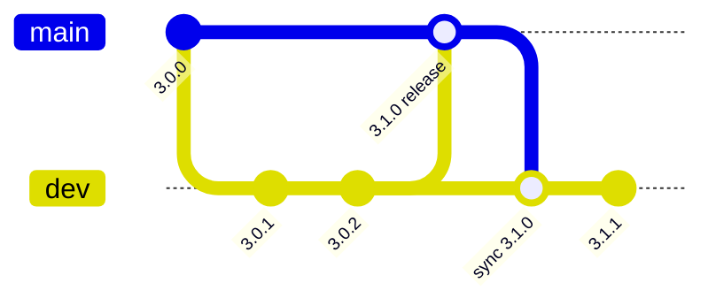

# Branching and versioning

BetterDesk uses two Git branches and automated product versioning across the repository.

## Branches

| Branch | Role | Version bump | GitHub Release |
|--------|------|--------------|----------------|
| **`dev`** | Active development; default target for pull requests | **+0.0.1** on every push (CI commit `[version-bump]`) | No — Docker images tagged `dev` / `sha-*` on GHCR |
| **`main`** | Stable production; stricter review and [PRE_RELEASE_CHECKLIST.md](../PRE_RELEASE_CHECKLIST.md) | **+0.1.0** when a PR is merged into `main` | Yes — tag `vX.Y.Z`, GitHub Release, server binaries, semver Docker tags |

### Typical flow

1. Feature branches merge into **`dev`** (patch version auto-increments).
2. When ready for production, open a PR **`dev` → `main`** and complete the release checklist.
3. On merge, CI bumps minor version, tags, and publishes a release.
4. Merge **`main` → `dev`** so development continues from the new minor baseline (e.g. `3.1.0` → next dev commits `3.1.1`, `3.1.2`, …).



## Product version files (Tier 1 + 2)

Canonical version: root [`VERSION`](../../VERSION) file.

Every automated bump updates these together:

**Tier 1**

- `VERSION`
- `betterdesk-server/VERSION` and `betterdesk-server/internal/productversion/VERSION` (Go `go:embed` + builds)
- `betterdesk.sh`, `betterdesk.ps1`, `betterdesk-docker.sh`, `install.sh`
- `CHANGELOG.md` (moves `[Unreleased]` → new section)

**Tier 2 (Docker)**

- `Dockerfile`, `Dockerfile.server`
- `docker-compose.quick.single.yml`, `docker-compose.quick.single.macvlan.yml`
- `docker/entrypoint.sh`

The web console is part of `betterdesk-server`, so the console and the server report the **same product semver**.

Sub-project versions (the SDKs under `sdks/`) are **not** bumped with the main product unless explicitly requested.

### Maintainer commands

```bash
# Verify all Tier 1/2 files match VERSION (CI runs this too)
go -C betterdesk-server run ./cmd/repotool bump-version --verify

# List every path touched by automated bumps (used by CI git add)
go -C betterdesk-server run ./cmd/repotool bump-version --list-paths

# Manual bump (normally CI handles this)
go -C betterdesk-server run ./cmd/repotool bump-version --patch    # +0.0.1
go -C betterdesk-server run ./cmd/repotool bump-version --minor    # +0.1.0
go -C betterdesk-server run ./cmd/repotool bump-version --set 3.2.0
go -C betterdesk-server run ./cmd/repotool bump-version --patch --dry-run
```

## GitHub repository settings (operator)

Configure once in GitHub (not in git):

1. **Default branch → `dev`** — new clones and PRs target active development.
2. **Protect `main`** — require PR, require status checks (`Go Server CI`, `Web UI CI`, `Secret Scan`, `Version Verify`), disallow direct push.
3. **Optional: protect `dev`** — require CI on PRs without release checklist.

## Update channel (stable / development)

Installations take updates from the GitHub releases of one channel:

| Channel | Branch | Installs | Use case |
|---------|--------|----------|----------|
| **Stable** | `main` | The newest release `vX.Y.Z` | Production (default) |
| **Development** | `dev` | The `dev` pre-release, rebuilt on every push to `dev` | Early testing |

### Panel (Settings → Updates)

Select **Stable** or **Development** and confirm. The setting is stored in the console's `.env` as `UPDATE_GITHUB_BRANCH`; the server reads that file through `BETTERDESK_ENV_FILE`.

After switching channel, run **Check for updates**: the next check compares the installed version with the new channel.

### Installer scripts

- **Linux:** `betterdesk.sh` → Update → **Switch update channel**
- **Windows:** `betterdesk.ps1` → Update → **Switch update channel**
- **Docker:** `betterdesk-docker.sh` → Update → **Switch update channel**

Environment variable (all paths):

```bash
UPDATE_GITHUB_BRANCH=main   # stable
UPDATE_GITHUB_BRANCH=dev    # development
```

## CI workflows

| Workflow | Trigger | Action |
|----------|---------|--------|
| `version-bump-dev.yml` | Push to `dev` | Patch bump + commit `[version-bump]` |
| `version-bump-main.yml` | PR merged to `main` | Minor bump, tag, GitHub Release; starts `release-go.yml` for the tag with `channel=stable` and `docker-publish.yml`, since a tag pushed with the workflow's token starts no workflow |
| `version-verify.yml` | Push/PR touching version files | Fail if files disagree |
| `release-go.yml` | Tag `v*`, push to `dev`, or dispatch | The only publisher of server binaries: the stable release `vX.Y.Z` for a tag, the pre-release `dev` for `dev`. Binaries with the web console built in, `manifest.json`, `SHA256SUMS` and, when signed, `manifest.sig`, which the console's updater installs from |
| `release-server.yml` | Push to `main`/`dev`, tag `v*` | Builds the server binaries and the migration tool as run artifacts only; attaches nothing to a release |
| `docker-publish.yml` | Tag, release, push to `main`/`dev`, or dispatch from `version-bump-dev` | GHCR images: on **branch** pushes, builds only version-bump subjects so image VERSION matches tip (#401); `version-bump-dev` dispatches `tag=dev` because GITHUB_TOKEN pushes do not re-trigger workflows. Tags/release/dispatch always build. `latest` on stable release/main; `dev` on development publishes; semver on `v*` / Release. `betterdesk` and `betterdesk-server` are multi-arch (amd64 then native ARM); soft-merge still publishes amd64 if ARM fails (#476) |

## First stable release note

If `VERSION` is `3.0.0` but no `v3.0.0` tag exists yet, create it once manually after enabling this workflow, or merge the first PR to `main` to let CI publish `v3.1.0`.
